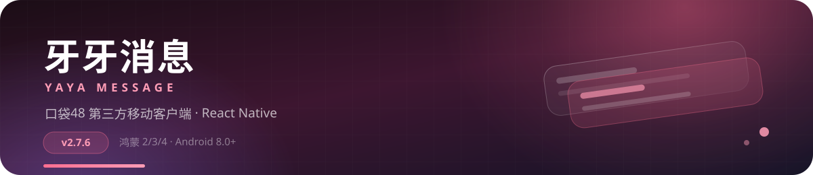

<p align="center">
  
</p>
<p align="center">
  
</p>

<p align="center">
  <a href="LICENSE"></a>
  <a href="https://github.com/Xenia0922/yaya_msg_mobile/releases"></a>
  
</p>

# 牙牙消息

口袋48 第三方移动客户端（React Native），基于 [yk1z/yaya_msg](https://github.com/yk1z/yaya_msg) 二次开发。

> **⚠️ 重要：由于版本更新较大，建议每一位用户卸载后重新安装软件！**

## 待发布（v2.7.6）

> 逐项改动明细（现象 / 根因 / 涉及文件 / commit）见 [`docs/RELEASE_NOTES_2.7.6.md`](docs/RELEASE_NOTES_2.7.6.md)。

**房间映射：修复大小房间错乱**
- 修复「大房间点开是小房间 / 大小房间错位」：补 channelId 缺口时用最新消息反推，而该接口对**同一个 serverId 会返回多条**（大房间 + 小房间 + 历史房间，顺序不固定，实测有成员一次返回 11 条），旧逻辑取到的是小房间或历史房间 id，且被写进本地缓存后无法自愈。现改为**每个 serverId 只认第一条**，并**排除属于任何成员的小房间 id**
- 成员库缓存与房间映射缓存**升级换代**（v7 / v3），自动丢弃历史脏数据
- 修复部分成员「房间凭空消失」：成员库镜像改为**多 CDN 端点重试**（cdn / fastly / testingcf / gcore），单个 jsDelivr 域名不可达时，不再一路退化成「没有房间映射」的官方目录
- 适配上游成员库改版：上游不再返回 `status` 字段后，非在团成员不再显示为「未知状态」，而是正确归类为已毕业
- **修复「数据源不可用 → 成员变 900 且大小房间错位」**：官方备用目录恰好 900 位、且**不含任何房间字段**，一旦退化，房间只能靠最新消息反推而必然错位。现在成员库源不可用时会**保留本地数据**，不再接受这种退化

**成员库更新时效**
- 成员库改为**上游一变就同步**：上游数据变更后**最长 2 分钟**即生成并发布
- App 侧缓存 TTL 由 6 小时缩短到 **10 分钟**，且每次启动都会**后台静默刷新**（不阻塞启动），不再出现「后台明明更新了，App 里还是旧数据」

**新增：房间相册回来了**
- 首页工具区「相册」入口恢复：选成员 → 大房间 / 小房间 → 图片 + 视频网格（点图放大、点视频直接播、长按下载、上滑翻页、下拉刷新）
- 风格与现版本统一：大/小房间用全站标准玻璃分段控件；小房间只在成员确实有小房间时才出现
- 接口与桌面版**完全一致**，此前只是界面被删（当年"有问题"的真因是播放器重写后一个导入路径失效）

**鸡腿榜（多处修复）**
- 修复**切换周次/页签的一瞬间日期栏"塌一下"**：根因是 chip 被压扁后字形被裁、以及选中态切换那一帧背景按内容边界绘制（逐帧取证）
- 修复**点当前已选中的日期/页签会把榜单清空且不再恢复**（表现为"双击日期像刷新"）
- 页签改为全站标准玻璃分段控件（原先是一块占半屏的实心粉胶囊）
- 领奖台压低高度、数值居中、第一名改为淡粉底（原先是占近半屏的实心色块）
- 偶发 504 现在会自动重试（3 次退避）；上拉加载在"翻不了页"时不再空转

**小窗（画中画 / 应用内小窗）**
- 修复**小窗正在播时打开全屏播放器、按 Home 不弹系统悬浮窗**：多个播放源各自覆写"是否有媒体在播"标志，后写者把前者的状态踩掉；改为按来源登记、任一路在播即为真
- 修复**小窗右上角两颗按钮图标一模一样**（「全屏」与「尺寸档位」都是 `arrow-expand`）：档位按钮改用 `resize`，语义分开

**播放器底坞（本轮）**
- 底坞纵向间距改为**按屏高自适应**（`dockScale = clamp(0.82~1, 屏幕高/820)`），小屏不再整体偏高
- 弹幕输入框收薄（`minHeight 36→34`、`paddingVertical 8→6`）

**翻牌（本轮）**
- 修复**翻牌统计里语音/视频翻牌没有播放按钮、也没有秒数**：URL/时长此前只从 `answerContent` 解析，现增加条目自身字段兜底（`answerUrl` / `answerDuration` / `answerSecond` 等）

**音乐库（本轮）**
- 修复**一首歌播完自动切下一首后，刚播完那张卡片的专辑封面变空白**：封面高亮描边宽度改为恒定（非播放态透明占位），封面撑满方式改为绝对定位贴齐 —— 切歌不再触发封面子树重排导致的尺寸塌陷
- 修复**进入音乐页后整页卡死（点什么都没反应）**：时长缓存让播放心跳每 0.5s 触发一次全页重渲染 + 800KB 持久化序列化，JS 线程被打满；**列表上的时长显示已全部移除**（歌曲卡/专辑卡都不再显示时长）

**设置页（本轮）**
- 关于区新增 **010 推送** 入口（`gnz48.tech`），紧挨「下载页」

**应用内更新（新增）**
- 设置页检查到新版本后可**直接在应用内下载并安装**：自动选择本机 ABI 的分包（v8a / v7a / x64），下载进度可见，完成后拉起系统安装器
- 未授予「安装未知应用」权限时会引导去系统设置，授权返回后自动继续安装，无需重新下载

**房间礼物 / 关注列表 / 鸡腿榜 / 消息装饰（本轮）**
- 修复**点房间礼物按钮面板空列表**：小房间模式下坐标误用大房间 channelId/serverId，改为与发言同源的活跃房间坐标
- 修复**已关注成员不显示在房间列表**（如周文迪）：关注接口补签名头 + 成员库静默刷新后重新匹配
- 鸡腿榜**去掉年榜**；成员贡献页新增「查询成员 / 总贡献值 / 贡献人数」头部卡，贡献列表加进度条与前三徽标
- 修复**消息勋章 / 头像框不渲染**（图床域名拼错）；`[发呆]` 等**官方表情改为表情图内联渲染**（107 个 PopoEmoticons）


## 最新更新（v2.7.5，对比 v2.7.4 共 144 个提交）

**房间 / 消息**
- 消息身份重做：每条消息独立成组；非房主成员发言也按成员档案渲染（名字/头像/队标）；皇冠只给房主
- 点头像看资料：成员进「成员档案」，粉丝弹资料卡（可关注 / 私信）
- 房间内搜索：单列行卡结果 + 搜索框原位嵌入工具条（纯聊天记录搜索）
- 语音播放卡液态玻璃化；房间公告进房间不再依赖播放器；发消息立即上屏

**私信**：支持发图与长按删除；日期分隔；消息顺序修正

**上麦 / 电台**：房间内直接开播（音频小胶囊跨页续播）；手动强制重扫；只扫在团成员

**播放器**：弹幕列表抽屉（内容/发送者搜索、发送者榜、录播跳时间、资料卡）；直播公告默认展开可收起；直播断流自动重连；竖屏小窗不再被裁

**翻牌**：整页翻牌统计（概览 / 类型分布 / 成员排名 / 明细）

**性能**：全站图片缩略图（渲染线程 29%→5.9%）；音乐缓存自递归修复（空闲 CPU 129%→7%）；模糊降采样与网格去逐卡玻璃（三星滚动掉帧大头）

## 功能

- 房间消息 / 私信 / 翻牌
- 口袋直播与回放
- 公演主播（B站直播）
- 官方音乐库
- 翻牌统计、成员数据库、鸡腿充值

## 安装
从[下载页](https://gnz48.tech/app/)下载

从[夸克网盘](https://pan.quark.cn/s/5b103245218a)下载

从 [Releases](https://github.com/Xenia0922/yaya_msg_mobile/releases) 下载：

- `yaya-msg-mobile-v2.7.5-universal.apk`：通用包（全 ABI，体积最大）
- `yaya-msg-mobile-v2.7.5-x64.apk`：x86_64 模拟器专用
- `yaya-msg-mobile-v2.7.5-v8a.apk` / `-v7a.apk`：真机包（**推荐真机使用**，比通用包小约 40%）

模拟器请用 x64 包，否则无法启动。App 内「检查更新」始终提供通用包直链，真机如需最小体积请在 Release 页面按架构下载。

## 构建

```sh
npm install --legacy-peer-deps
node scripts/build-apk.js
```

## 兼容

鸿蒙 2/3/4 与 Android 8.0+（minSdk 26）。

## 已知问题


## 致谢

基于 [yk1z/yaya_msg](https://github.com/yk1z/yaya_msg) 二次开发，感谢原作者的开发与贡献。

## 免责声明

本应用为**非官方第三方客户端**，与丝芭传媒（SNH48 Group）及口袋48官方无任何关联，未获得其授权或认可，请以官方客户端为准。

- 应用展示的直播、视频、音乐、图片、文本等内容的版权归原权利人所有；
- 本应用仅为个人技术学习与交流目的开发，不代表任何官方立场，不保证内容持续可用；
- 请勿将本应用及其中内容用于商业用途或任何盈利活动；
- 使用本应用可能产生的任何风险（含账号安全风险）由使用者自行承担；
- 如内容涉及侵权或您认为不妥，请与仓库维护者联系处理。

