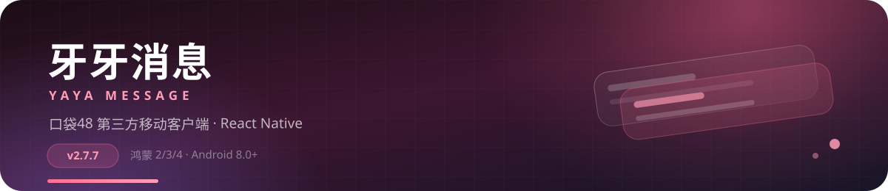

<p align="center">
  
</p>
<p align="center">
  
</p>

<p align="center">
  <a href="LICENSE"></a>
  <a href="https://github.com/Xenia0922/yaya_msg_mobile/releases"></a>
  
</p>

# 牙牙消息

口袋48 第三方移动客户端（React Native），基于 [yk1z/yaya_msg](https://github.com/yk1z/yaya_msg) 二次开发。

> **⚠️ v2.7.5 之前的旧版本建议卸载后重装；v2.7.5 及之后可直接覆盖安装。**

## 最新更新（v2.7.7 · 2026-11-05）

**新增**

- 新增手机号注册：没有口袋账号也能直接注册
- 新增密码登录与安全验证：与验证码登录共用设备头，答错可重新取码
- 新增口袋48 / 塞纳河48 登录身份切换：在塞纳河客户端注册的账号切身份即可登录
- 新增整账号快速切号：保存多个账号（Token + 登录身份），一键切换
- 新增房间表情包与贴纸面板：官方表情分组展示，支持搜索
- 新增翻牌提问卡：问题与提问者一目了然（尊重匿名与仅本人可见）
- 新增头像框与勋章装扮：选项取自官方接口，仅作用于当前账号
- 新增公演成员榜

**修复**

- 修复私信图片不显示：字段与域名判定修正，图片可点开大图
- 修复私信头像不显示与资料卡缺失：点开头像看资料（关注 / 私信）
- 修复私信红点被误清零
- 修复房间消息不自动刷新：房间页 2s 持续更新，不用切页面
- 修复上滑看历史被新消息拽回底部：露「回到底部 / N 条新消息」气泡
- 修复系统小窗唤不出与播放器 UI 残留：按 Home 可正常缩进小窗
- 修复进出房间偶发闪退（Fabric 挂载竞态）
- 修复房间页浮出首页内容
- 修复底栏在媒体页隐藏后影响房间页
- 修复成员库被旧数据覆盖，导致房间映射丢失、大小房间进不去
- 修复签名超时导致接口成批失败：并发合并 + 渲染进程失活自愈
- 修复下载完成却被判失败
- 修复账号设置页输入框被键盘遮挡
- 修复私信发送后整屏闪烁
- 修复媒体页关闭播放器后列表卡骨架屏
- 修复送礼连点重复扣费
- 修复私信会话时间分组错误
- 修复资料卡第二次打开同一人关注失败
- 修复非中文界面错误提示失效
- 修复歌词显示「词：…」「录音：…」「歌名 - 歌手」
- 修复首页工具入口文字被截断

**优化**

- 重写直播弹幕浮层：头像自动补全、可过滤进场消息、字号与透明度可调
- 优化切页与长会话流畅度：切走的页面冻结渲染、消息对象复用、资料卡带缓存
- 优化房间消息渲染开销
- 优化进出房间动效（UI 线程驱动）

明细见 [v2.7.7 发布说明](docs/RELEASE_NOTES_2.7.7.md)。

## 功能

- 房间消息 / 私信 / 翻牌
- 口袋直播与回放
- 公演主播（B站直播）
- 官方音乐库
- 翻牌统计、成员数据库、鸡腿充值

## 安装
从[下载页](https://gnz48.tech/app/)下载

从[夸克网盘](https://pan.quark.cn/s/5b103245218a)下载

从 [Releases](https://github.com/Xenia0922/yaya_msg_mobile/releases) 下载：

- `yaya-msg-mobile-v2.7.7-universal.apk`：通用包（全 ABI，体积最大）
- `yaya-msg-mobile-v2.7.7-x64.apk`：x86_64 模拟器专用
- `yaya-msg-mobile-v2.7.7-v8a.apk` / `-v7a.apk`：真机包（**推荐真机使用**，比通用包小约 60%）

模拟器请用 x64 包，否则无法启动。App 内「检查更新」始终提供通用包直链，真机如需最小体积请在 Release 页面按架构下载。

## 构建

```sh
npm install --legacy-peer-deps
node scripts/build-apk.js
```

## 兼容

鸿蒙 2/3/4 与 Android 8.0+（minSdk 26）。

## 已知问题

## 致谢

基于 [yk1z/yaya_msg](https://github.com/yk1z/yaya_msg) 二次开发，感谢原作者的开发与贡献。

## 免责声明

本应用为**非官方第三方客户端**，与丝芭传媒（SNH48 Group）及口袋48官方无任何关联，未获得其授权或认可，请以官方客户端为准。

- 应用展示的直播、视频、音乐、图片、文本等内容的版权归原权利人所有；
- 本应用仅为个人技术学习与交流目的开发，不代表任何官方立场，不保证内容持续可用；
- 请勿将本应用及其中内容用于商业用途或任何盈利活动；
- 使用本应用可能产生的任何风险（含账号安全风险）由使用者自行承担；
- 如内容涉及侵权或您认为不妥，请与仓库维护者联系处理。

